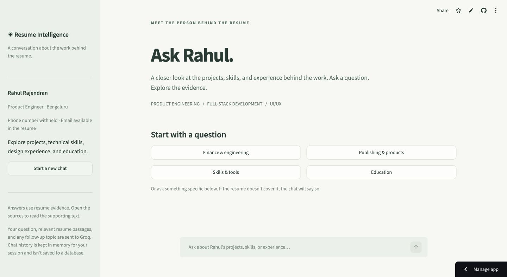
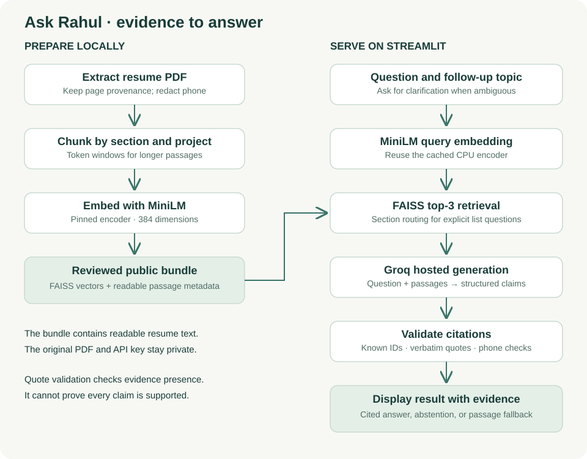
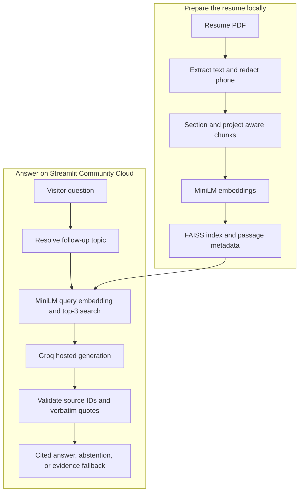
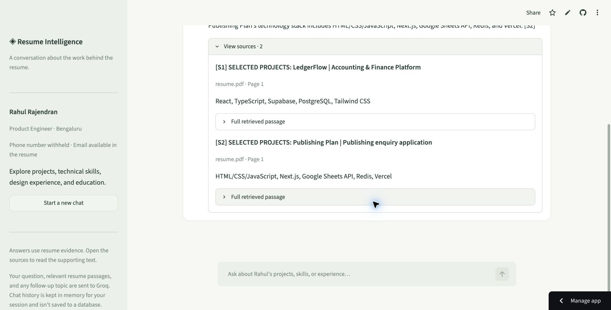

# Ask Rahul

**[Try the live chatbot](https://ask-rahul-rag.streamlit.app/)** ·
[Code walkthrough](docs/WALKTHROUGH.md) · [Deployment](DEPLOYMENT.md)

A resume RAG chatbot that answers questions about Rahul Rajendran's projects,
experience, skills, and education, with supporting resume passages attached.
Built with Python, Streamlit, MiniLM, FAISS, and a Groq-hosted LLM.



## What it does

- Retrieves relevant passages from a reviewed, phone-redacted resume index.
- Generates short answers with source IDs and verbatim evidence quotations.
- Asks for clarification when a follow-up has no clear project or role.
- Abstains on missing information and offers original passages when a generated
  summary fails citation validation.
- Keeps chat history in each Streamlit session's memory, without a chat database.

## Architecture



<details>
<summary>Mermaid diagram source</summary>



</details>

The embedding encoder produces 384-dimensional vectors on CPU. FAISS performs
exact normalized inner-product search, equivalent to cosine similarity. A JSON
manifest maps vector positions to source text, page numbers, labels, and IDs.
Both are packaged in one checked ZIP bundle.

The generative model is `openai/gpt-oss-20b`, hosted by Groq. No generative LLM
runs locally or on the Streamlit server. The encoder and index are cached across
sessions; conversation histories remain separate. Explicit project/role list
questions use section routing to improve coverage.



The screenshot records a hosted smoke check. Source quotations are verified by
code; whether they support the entire generated claim still needs judgment.

## Run locally

Use Python 3.12 from the repository root:

```bash
python3.12 -m venv .venv
source .venv/bin/activate
python -m pip install -r requirements.txt
```

Create `.streamlit/secrets.toml` privately:

```toml
GROQ_API_KEY = "your-key-here"
GROQ_MODEL = "openai/gpt-oss-20b"
```

```bash
streamlit run app.py
```

The reviewed index is included in `public_data/resume.rag.zip`. The first
question downloads the pinned MiniLM encoder; a fresh server can take longer.
An existing local `data/index/resume.rag.zip` takes precedence over the public
bundle. Streamlit Secrets holds the deployed key privately.

To replace the resume, first extract and review its text, then rebuild locally:

```bash
python -m resume_rag.ingest /path/to/resume.pdf
python -m resume_rag.retrieval build
```

Review the resulting passages before deliberately replacing the public bundle.
The bundle contains readable text; vectors do not make it private. The original
PDF is deliberately excluded from this repository.

## Evaluation

The development set has 25 questions, including 20 answerable retrieval cases.
The following results compare semantic search with section routing on the same
sanitized index and the same development questions:

| Retrieval measure | Semantic only | With section routing |
| --- | ---: | ---: |
| Complete expected evidence in top 3 | 18/20 | 20/20 |
| Mean expected evidence coverage | 93.3% | 100% |
| First relevant passage at rank 1 | 11/20 | 13/20 |
| MRR@3 | 0.7583 | 0.8250 |

Expected evidence is measured using annotated passage labels. These are small
development-set retrieval results, not answer accuracy or an independent benchmark.
For example, finding every expected passage does not guarantee the LLM uses it correctly.

Live evaluation made 14 authorized attempts: 12 provider responses and two
connection failures. Latest-per-case status checks matched expectations for
10/12 cases, mixing original tests and targeted rechecks. This was not a clean
full rerun. Two separate hosted smoke checks later passed: project-stack
comparison with full source lines, and salary abstention. They do not rewrite
the Phase 5 metrics.

```bash
# Offline fixtures and mocked provider calls: 58 tests passed during development.
python -m unittest discover -s tests

# Real encoder, retrieval only; no Groq call.
python -m resume_rag.smoke
python -m resume_rag.evaluate --semantic-only --output-dir data/processed/baseline
python -m resume_rag.evaluate --output-dir data/processed/section-aware
```

The seven retrieval smoke cases passed from the release bundle. Evaluation also
prepares request plans for review; the commands above do not send them to Groq.
Live generation is a separate operation that sends questions and resume passages.

## Project map

| File | Responsibility |
| --- | --- |
| `resume_rag/ingest.py` | PDF extraction, page provenance, and reviewed text output |
| `resume_rag/privacy.py` | Common phone-format redaction and checks |
| `resume_rag/retrieval.py` | Chunking, embedding, bundle persistence, and search |
| `resume_rag/answer.py` | Groq request, strict schema, citation validation, fallback |
| `resume_rag/conversation.py` | Conservative follow-up resolution |
| `resume_rag/ui.py` | Streamlit rendering, resource cache, and session history |
| `resume_rag/evaluate.py` | Retrieval measurements and proposed live requests |
| `tests/` | Offline checks, including UI and mocked provider behavior |

## Privacy, cost, and limitations

The public index includes professional resume text and email with the owner's
approval. Phone numbers, the original PDF, the real API key, and private test
responses are excluded. Phone filtering uses common-format heuristics and is
not a universal detector for obfuscated numbers.

Questions, relevant passages, and a resolved follow-up topic are sent to Groq.
History lives in server session memory and is not saved to a chat database.
Public resume claims are evidence for this chatbot, not independent verification
of the candidate's work.

The validator checks structure, allowed IDs, verbatim quotes, and phone privacy;
it cannot prove semantic entailment. There is no similarity threshold calibrated
to reject unrelated questions before generation. Unknown-information abstention
also depends on the hosted model's behavior.

Free hosting can sleep; first requests may be slow, and Groq quotas can reject
requests. The app does not enable billing or guarantee a zero bill on an account
whose owner changes its billing plan. There is no durable application-wide usage
budget. This is a small portfolio demo, with no uptime or accuracy guarantee.
